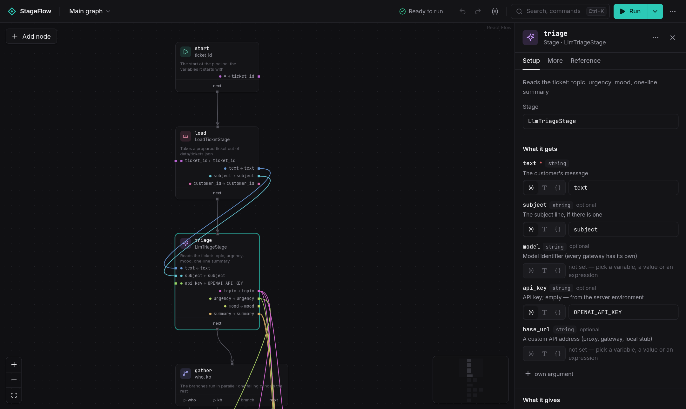
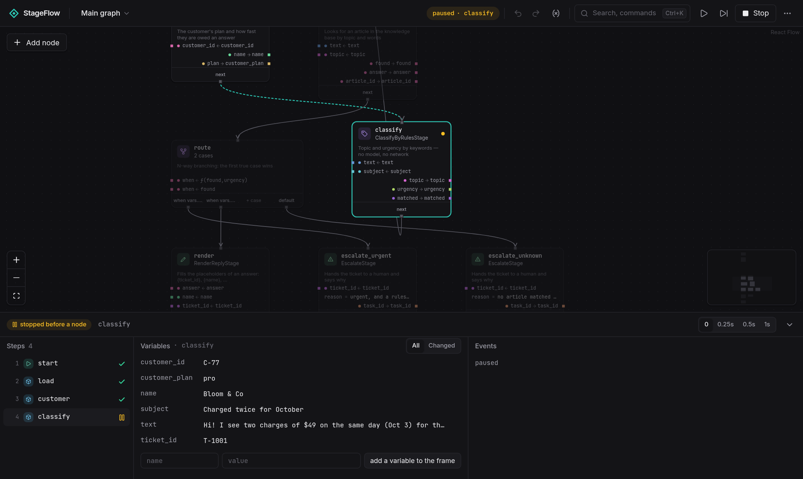

<div align="center">

# StageFlow Editor

**Draw a pipeline, run it on the real core, watch it go node by node.**

[](https://github.com/leo-need-more-coffee/stageflow-ui/releases)
[](LICENSE)
[](package.json)

[Try it](https://leo-need-more-coffee.github.io/stageflow-ui/) ·
[Try it on a live backend](https://leo-need-more-coffee.github.io/stageflow-ui/?backend=https://stageflow.lazy.su) ·
[Core](https://github.com/leo-need-more-coffee/stageflow) ·
[Example backend](https://github.com/leo-need-more-coffee/stageflow-example) ·
[Documentation](https://leo-need-more-coffee.github.io/stageflow/)

</div>



A visual editor for [StageFlow](https://github.com/leo-need-more-coffee/stageflow)
pipelines, in React and TypeScript, with the canvas drawn by
[React Flow](https://reactflow.dev). The graph model, the node kinds, the
validation and the run client are framework-free JavaScript in `src/core`,
tested on their own; the interface in `src/app` only draws them.

The editor holds no stages and executes nothing. It asks a StageFlow backend
for the stage specifications, draws the graph from them, and sends runs back
to that backend. So what the debugger shows is the core's own semantics, not a
second implementation of them in JavaScript.

## Run it

```bash
npm ci
npm run dev                    # http://127.0.0.1:5173, reloads as you edit
npm run build && npm start     # the built editor on http://127.0.0.1:8080
```

or:

```bash
docker compose up --build      # http://127.0.0.1:8080
```

Then type the address of a backend on the connection screen — for example
`http://127.0.0.1:8765` if you are running the
[example](https://github.com/leo-need-more-coffee/stageflow-example). The
address is remembered, and `?backend=http://host:port` in the URL skips the
question. A backend that wants a credential gets one from the folded-away
**Authorization** field on the same screen — header name as well as value,
because the editor has no business deciding what a credential is called.

## Nothing to run? There is a public one

The [example backend](https://github.com/leo-need-more-coffee/stageflow-example)
is up, so the editor has something to talk to without installing anything:

**[Open the editor on it →](https://leo-need-more-coffee.github.io/stageflow-ui/?backend=https://stageflow.lazy.su)**

```
https://stageflow.lazy.su
```

It is a support bot: load a ticket, find out what it is about, search a
knowledge base, then reply or hand the ticket to a person. The bot's stages,
plus the ones the core ships with. It runs on the current release of the core.
There is no model key on the server, so the stages that call a model fail —
and a pipeline built for that falls back to keyword rules, which is worth
watching in the debugger.

Seven ready-made graphs are served alongside it, the same bot at seven sizes.
Save one and open it with **⋯ → Import JSON…**:

| | Shows |
|---|---|
| [`01-triage.json`](https://stageflow.lazy.su/pipelines/01-triage.json) | a straight line: load a ticket, let the model read it |
| [`02-auto-reply.json`](https://stageflow.lazy.su/pipelines/02-auto-reply.json) | a knowledge base search and the first `condition` |
| [`03-routing.json`](https://stageflow.lazy.su/pipelines/03-routing.json) | `parallel`, then a `switch` on urgency |
| [`04-support-bot.json`](https://stageflow.lazy.su/pipelines/04-support-bot.json) | `try`/`except` down to keyword rules, `retry`, a subpipeline |
| [`05-batch-triage.json`](https://stageflow.lazy.su/pipelines/05-batch-triage.json) | `map`: one region of the graph per ticket |
| [`06-rules-only.json`](https://stageflow.lazy.su/pipelines/06-rules-only.json) | the whole bot with no model — what the `basic` plan is built around |
| [`07-agent-review.json`](https://stageflow.lazy.su/pipelines/07-agent-review.json) | `wait`: the draft waits for a person, saved on the server |

No credential is needed: visitors run on the open plan, four runs going at
once across everybody, and the backend holds no secrets. The bot has two
narrower plans as well. [`&plan=basic`](https://leo-need-more-coffee.github.io/stageflow-ui/?backend=https://stageflow.lazy.su&plan=basic)
on the editor's own address shows what the cheapest one allows **without being
on it** — the add menu narrows to rules and plain nodes, `map` and the model
stages grey out with the reason, the ceilings drop to 15 seconds and 200 steps;
[`&plan=pro`](https://leo-need-more-coffee.github.io/stageflow-ui/?backend=https://stageflow.lazy.su&plan=pro) shows the paid
one. A run still goes on the plan the credential says. That is the policy
mechanism the [core documents](https://leo-need-more-coffee.github.io/stageflow/policy/):
drawing is not running, and a name is not a permission.

If the connection screen says the backend is not reachable, the request is being
blocked before it leaves the browser — a blocklist, usually. The editor cannot
tell that apart from the backend being down; the browser's network tab, or
uBlock's logger, can.

`server.js` is a hundred lines of static file serving with no dependencies of
its own; it serves `dist/`, which `npm run build` writes.
`PORT` and `HOST` come from the environment (`UI_PORT` in compose).

## What it does

- **The graph is built on the canvas.** Pull a wire from a port onto a node to
  link them, or into empty space to create one there; **+** on a wire inserts
  a node into it. Every way of adding a node ends with a connection, and the
  add menu is a finder that stays usable with hundreds of stages.
- **Two kinds of connector on two axes.** Execution order runs vertically and
  is the real `next` of the JSON; data flows run horizontally, are derived from
  the graph, and are coloured per variable.
- **Regions are derived, not drawn.** The branches of a `parallel`, the body
  and handlers of a `try`, the body of a `map` loop are framed from the
  structure of the graph, so a frame cannot disagree with it — and a card that
  only lies on a frame is marked as not part of it.
- **Subpipelines beside the main graph**, each in a frame of its own, edited in
  place.
- **The inspector comes from the stage spec.** Forms instead of hand-written
  JSON, with unfilled required arguments marked.
- **Step debugging on the real core**: the current node on the graph, stepping,
  a pace between nodes, frame variables you can read and edit mid-run, and
  answering a run that waits at a `wait` node.
- **It knows what the backend allows.** Node types it cannot run are greyed
  out, limits it would break are flagged before the run, and a run shows what
  it spent against what it was given.
- **Secrets stay out of the JSON.** Only the name of a key goes into the
  pipeline; values live in the store and never appear in the run panel or
  the event log.
- **An agent can draw on the same canvas** over the
  [bridge](docs/bridge.md), and the graph grows there as it works.
- **The interface speaks the reader's language.** A flat JSON catalog per
  language in `public/i18n/`, picked in **⋯ → Language** and remembered; a language
  is a file plus a line, and nothing in the code names one. A stage's prose is
  the backend's, so it arrives in every language the backend has and the editor
  picks — the choice is made where the reader is, not a request away.
- A command palette (`Ctrl+K`), `Ctrl+S` to a file, live validation, JSON
  import and export, undo/redo, a node clipboard, light and dark themes, and a
  session that survives a reload.



## Compatibility

The editor mirrors the core's node registry as it stood when the editor was
built, so an editor newer than the backend it is pointed at is the normal
case. It is not guessed from version numbers — the backend is asked:

```
GET /api/meta  ->  {"api": 1, "plan": "basic", "plan_source": "token",
                    "plans": ["basic", "full", "pro"], "stageflow": "0.13.0",
                    "node_types": [...], "stages": 5, "limits": {...}}
```

`node_types` is what this caller may use — the core's registry, narrowed by
whatever allowance the backend gives the caller. A type missing from it is
greyed out in the add menu with the reason, and a graph already using one says
so in the top bar **before** a run rather than failing halfway through it with
`Unknown node type`. The connection dialog shows the editor's version next to
the backend's plan, core and API.

`limits` is the other half, and the editor treats it the same way: what can be
judged from the graph is judged before the run. A graph whose shortest path is
longer than the allowed `steps`, or a `retry` asking for more attempts than
the backend permits, is an issue in the top bar rather than a surprise
partway through. What cannot be judged is left alone — a loop's cost comes
from its data, and guessing would refuse graphs that fit.

During and after a run the run panel shows what was spent against what was
allowed (`steps 412/5000`, `tokens 5120/200000`), which is the point of a
ceiling: to be visible before it is reached.

The **Plan** section of the connection dialog draws the graph against another
plan of the same backend
(`?plan=` on `/api/meta` and `/api/stages`; `?plan=basic` on the editor's URL
opens it that way). That is a **view** — unverified on purpose, because a name
is not a permission and an editor that must log in before it can grey out a
menu entry is one nobody configures. What a run may do is the backend's
decision, taken from the credential: a graph prepared for a plan you are not
on is refused when it starts, by name, instead of dissolving into stages that
"do not exist". The dialog marks a preview as one.

A backend that serves no `/api/meta` — an older one, or somebody else's — is
not second-guessed: nothing is marked and everything works as before, because
a false "unsupported" would be worse than the error being avoided.

| Editor | Speaks | Needs |
|---|---|---|
| 1.0.x | api v1 | any StageFlow backend; core ≥ 0.10 to be asked what it runs, ≥ 0.12 for the per-caller answer and the limits; a backend that saves waiting runs to answer a `wait` node |
| 0.4.x – 0.6.x | api v1 | any StageFlow backend; core ≥ 0.10 to be asked what it runs, ≥ 0.12 for the per-caller answer and the limits. Credentials and `?plan=` need a backend that wants them — one that ignores both behaves exactly as before |
| 0.3.x | api v1 | any StageFlow backend; core ≥ 0.10 to be asked what it runs, ≥ 0.12 for the per-caller answer and the limits |

## Releases

A tag builds two things (`.github/workflows/release.yml`): a GitHub Release
with the static files zipped, and an image in GHCR.

```bash
docker run --rm -p 8080:8080 ghcr.io/leo-need-more-coffee/stageflow-ui:latest
```

The hosted demo at
[leo-need-more-coffee.github.io/stageflow-ui](https://leo-need-more-coffee.github.io/stageflow-ui/)
is the same files, deployed from `main`, and it is a full client rather than a
demonstration: point it at a backend of your own, give it a credential, pick a
plan, all from the interface — **⋯ → Connection…**. Nothing is configured at
build time, because on a
static page nothing can be.

It is served over https, so the backend has to be reachable from a secure
page: `https://…`, or loopback, which browsers allow (the example backend
answers Chrome's private-network preflight). A plain http address elsewhere is
blocked before the request is made — the dialog says so rather than letting it
read as a backend that is switched off.

The version lives in two places, `package.json` and `src/core/version.js`;
`npm test` fails if they disagree, and so does the release workflow if
the tag does not match both.

## Documentation

| Page | What it covers |
|---|---|
| [The backend](docs/backend.md) | the endpoints the editor needs, CORS, the shape of a stage spec |
| [Building a graph](docs/canvas.md) | connectors, gestures, the add menu, regions, subpipelines beside the graph, auto-layout |
| [The interface](docs/interface.md) | the top bar and hotkeys, the inspector, the variable index, the theme, the language, the session |
| [Running and debugging](docs/running.md) | the run panel, the pace, starting variables, runs that wait, the run API |
| [Secrets](docs/secrets.md) | where keys live and why they are not in the pipeline |
| [The bridge to an agent](docs/bridge.md) | letting an assistant draw on this canvas, and read back what you drew |
| [Embedding](docs/embedding.md) | `createEditor` options, the public API, bundling catalogs |

## Tests

The core's tests are plain node scripts; the interface is checked by the
type checker and the build:

```bash
npm test && npm run typecheck && npm run build
```

They cover what the eye misses: that every node kind has a port for the next
node, that inserting into an edge keeps the tail of the graph, that 291 random
layouts produce no overlaps and no foreign node inside a region frame, that
undo/redo walks real edits only, that pasted copies are independent, that
secret values never leave the store, that an older backend is degraded against
rather than guessed about, that the credential goes on every request while
`?plan=` goes on none of the ones that run anything, and that every key the
interface asks for is in the catalogs of every language — a missing one is not a
crash, only a reader seeing `delay.one.hint` on the screen.

## Known limitations

Stepping is one node at a time — there are no breakpoints yet — and a run's
trail is drawn on the main graph only, not inside the frames of subpipelines
shown beside it.

## License

MIT — see [LICENSE](LICENSE).
