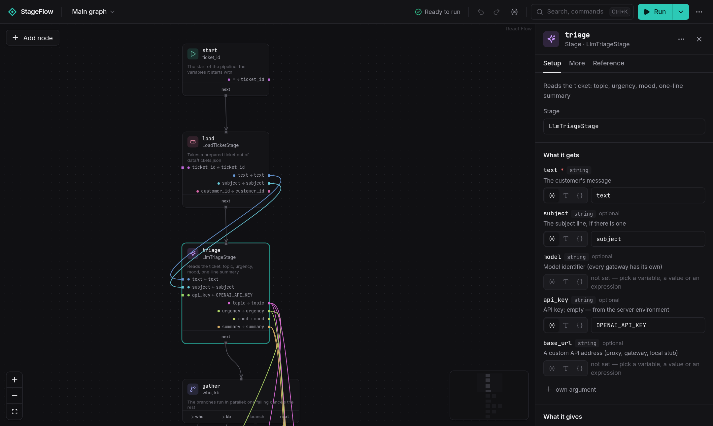

# The interface

The window is the canvas. Everything else either sits along its edges or
appears when it has something to say:

| where | what |
|---|---|
| the top bar | the graph you are on, whether it is sound, undo/redo, the variables, the search, **Run** |
| the right side | the inspector, while something is selected |
| the bottom | the run panel, while a run is on or has just ended |
| over the canvas | the add button, the zoom, the minimap, and notes from an agent on the [bridge](bridge.md) |

## The top bar

The bar is kept to what is used all the time. The rest — files, settings,
secrets, the stage registry, the connection, the theme, the language — is in
the **⋯** menu on the right and in the command palette.

- **The graph switcher** shows the main graph or the subpipeline open on its
  own. Its menu lists the subpipelines, creates and removes them, and switches
  **"Subpipelines beside the main graph"**: each one drawn in a frame next to the
  main graph and edited in place (see [Building a graph](canvas.md#subpipelines-beside-the-graph)).
- **The state chip.** "Ready to run" while the graph is sound, the number of
  issues when it is not — a click lists them, and a click on one takes you to
  the node. While a run is on, the chip is the run's state instead
  (`running · triage`, `waits for an answer · review`).
- **(x)** opens the variable index (below).
- **Search and commands** (`Ctrl+K`) is the command palette: every action,
  every node of the graph by name, adding a node.
- **Run** runs; its arrow offers step-by-step debugging and the pace. During a
  run the same place holds pause/continue, step and stop.

Every control in the bar is 32 px high and every group is set off by a rule, so
the bar reads as four groups rather than a row of icons.

## Hotkeys

| keys | action |
|---|---|
| `Ctrl+K` | the command palette |
| `A` | add a node (next to the selected one, if any) |
| `Ctrl+S` / `Ctrl+Shift+S` | save the pipeline as JSON / save it somewhere else |
| `Ctrl+Z` / `Ctrl+Shift+Z` (`Ctrl+Y`) | undo / redo |
| `Ctrl+C` / `Ctrl+X` / `Ctrl+V` | copy, cut, paste nodes |
| `Ctrl+D` | duplicate the selection |
| `Ctrl+A` | select every node of the graph |
| `Delete` / `Backspace` | delete the selection |
| `Esc` | clear the selection |
| `Shift+F` / `Shift+L` | fit the graph to the screen / lay it out again |
| `F5` / `Shift+F5` / `F10` | run / debug step by step / step |

On a Mac `Ctrl` is `⌘`. The letter is taken from `event.code`, not
`event.key`, so the shortcuts work on any keyboard layout. Inside a text field
they are left to the browser — `Ctrl+Z` there undoes the typing — except
`Ctrl+K` and `Ctrl+S`, which first commit what was typed.

**Saving.** Where the browser can write files (Chromium), the first `Ctrl+S`
asks where to save and later ones write the same file in place;
`Ctrl+Shift+S` asks again. Elsewhere it downloads `pipeline.json`. **⋯ →
Export JSON…** shows the JSON to copy.

## The inspector

Selecting a node opens its form on the right. The form follows the order in
which a node is thought about:

| tab · section | what is inside |
|---|---|
| **Setup** · no heading | the node's main field: the stage, the condition, the branches, the handlers |
| **Setup** · What it gets | a row per argument **declared by the stage spec** |
| **Setup** · What it gives | a row per result field: a switch "save it" and the variable it goes into |
| **Setup** · Next | the node's order ports (`next`, `then`/`else`, `body`, `default`, `on_timeout`) |
| **More** | the node's name, entry, `retry`, `consume`, `expose`, keys the editor does not know |
| **Reference** | the stage's spec as the backend sent it |

The rows come **from the spec**, not from the node's JSON: the stage has said
what its arguments are — name, type, whether required, description — and the
panel shows them all, to be filled in rather than guessed. What the spec does
not declare (somebody else's pipeline, a stage without a docstring) is listed
below the declared rows; nothing is lost.

- **The source of a value is a choice of three buttons:** a variable `(x)`, a
  value `T`, an expression `{}`. A value follows the type from the spec: a
  switch for `bool`, a number for numbers, JSON for a list or an object.
- **A variable name is picked, not typed**: the field suggests the names the
  graph already has, so a typo does not quietly create a second variable.
- **A missing required argument is marked at once**, and the same issue is in
  the state chip. An output the stage does not return is marked the same way.
- **What a stage does not define cannot be invented.** When a stage declares
  its outputs, the button below them adds "a variable from an expression" (a
  key with `.$`) rather than a free-form field.

The expression fields of the node kinds — the `condition`, a case's `when`, a
loop's `items` — use the same three sources, read back from the CEL text
(`vars.x` is a variable, `["a","b"]` a value, anything else an expression).

An unfinished row of a table (no variable name yet, a case without `when`)
lives in the panel as a draft until it is complete, because JSON has no way to
hold half a row.

Selecting several nodes shows the selection instead of a form; a click on a
name narrows it to that node.

## The variable index

**(x)** in the top bar lists the graph's variables: `name — who writes it →
who reads it`, with the colour of its wires. It shows the two mistakes nothing
else catches: a variable **nobody writes** (its readers get nothing) and one
**nobody reads** (the write is wasted). Neither is invalid JSON, so validation
is silent about both. Hovering a line lights the variable's path up on the
canvas.

## What makes a node recognisable

- **The icon** from the stage's docstring — a glyph or an emoji, a link to an
  SVG, a data URI or inline `<svg>`; `icon_mono: true` paints an SVG in the
  node's colour. Without one, a monogram of the name, so two stages are
  still told apart. Node kinds have icons of their own. Foreign SVG never reaches the page as markup — only
  as an `` or a CSS mask, so an icon from a third-party registry cannot
  run script.
- **The colour** from the docstring, or a stable colour per stage category.
- **The description**, two lines under the title; **⌘K → Stage descriptions
  on the cards** hides them.
- **Value settings** as `argument = value` rows (`url = https://…`, `delta =
  10`): they have no connector, because their source is the pipeline itself,
  but a `fetch` without its `url` shown would be "some request somewhere".
- **The wires of a card** are in the colour of their variable: what it reads
  on the left, what it writes on the right.

## The theme and the language

**⋯ → Theme**: system, light or dark; the choice is remembered. The two themes
are one set of colour tokens with two sets of values, so a colour means the
same thing in both.

**⋯ → Language.** The interface's text lives in `public/i18n/<tag>.json` — a
flat `{key: string}` catalog per language — and the languages on offer are the
keys of `public/i18n/index.json`, each named in its own language. Nothing in
the code names a language except the fallback (`en`), so adding a language is
adding a file and a line.

The language is decided in this order: `?lang=ru` in the address, then the
reader's last choice, then the browser. `ru-RU` finds the `ru` catalog. Two
catalogs are held at once, the chosen one and the fallback, so an unfinished
translation reads as English where it is unfinished; plural forms come from
`Intl.PluralRules`. A stage's prose comes from the backend in every language
it has, and the editor picks one (see [Embedding](embedding.md#languages)).

## The session

- **Undo and redo** walk the edits you made: a hundred snapshots of the
  pipeline. Actions that change nothing (switching graphs, specs arriving) do
  not get in, and undoing an edit made in a subpipeline goes back into it.
- **The node clipboard.** A paste lands under the cursor and becomes the
  selection. References inside the pasted set move onto the copies; one
  pointing outside is kept if that node exists and cleared if not. A second
  `entry` is not pasted. The clipboard is the editor's own, so pasting needs
  no browser permission.
- **A reload resets nothing** when `storageKey` is set: the pipeline, the open
  graph, the view and the frames of subpipelines go to `localStorage`, with a
  deferred write that is quietly skipped when storage is unavailable.

The invariants are tested on their own: `node tests/history.mjs` (only real
edits are recorded, a new edit cuts off the undone branch, loading another
pipeline starts over) and `node tests/clipboard.mjs` (references move onto the
copies, no second `entry`, one `Ctrl+Z` undoes a whole paste).
