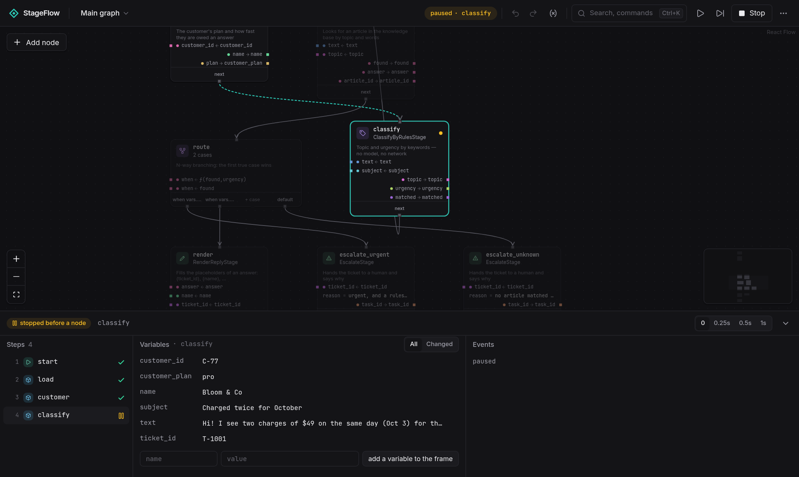

# Running and debugging



**Run** in the top bar (`F5`) drives a pipeline to the end; its arrow offers
**Debug step by step** (`Shift+F5`), which stops before the very first node
and goes on by command — `F10` or the step button that takes Run's place in the
bar. The run panel opens at the bottom:

- **the header**: the state, the node, an error if there is one, the pace, and
  the meters the backend keeps;
- **Steps**: every node the run has entered, in order, with what became of it;
- **Variables**: the frame at the selected step — **all** of it, or only what
  that step **changed** — editable while the run stands still;
- **Events**: the stream as it came, a node's streamed text and the result and
  artifacts at the end.

On the canvas the current node is ringed and spins, the passed ones are ticked
and the wires the run went along are drawn in the accent colour, the one it is
going along right now dashed and moving. Nodes the run has not reached are
dimmed. A run moving on to a node off screen brings it into view. The panel's
height is dragged by its top edge, and the panel folds to its header.

## The pace is set before the start

Without a delay a pipeline finishes before the eye can follow it: the nodes
all flash at once. Stepping by hand shows it honestly, but talking about a
pipeline while pressing `F10` on every node is awkward — so between "at once"
and "a node per key" there is a pace one simply watches: a pause between nodes,
held by the core (`StepDebugger(delay=…)`) rather than by a timer in the
browser, so it does not drift from the real execution.

The pace is one value (`Editor.runDelay`, which survives a reload), set in
three places: under Run's arrow, in the run dialog next to the starting
variables (a field, so that "three seconds a node" can be typed), and in the
run panel's header, where it changes the pace of a run **already going** —
"too fast, I did not get to explain" is found out in the middle of a
demonstration, and there is nothing to restart for that.

## Starting variables

**Before a run the editor asks for the starting variables.** They are declared
by the `entry` node as **default values**: a name that comes from outside is
neither overwritten nor evaluated by the node. So "run it with another `n`" is
a run with arguments rather than an edit of the JSON. In the dialog an empty
field means "as in the pipeline" — the declared value is a placeholder, not
text — so both the default and what was overridden are visible, and a computed
variable (`total.$`) cannot be wiped by accident. A row below adds a variable
the `entry` does not have. What was typed is remembered for the next run,
**↻** in the panel repeats the run with the same arguments without asking, and
loading another pipeline forgets them.

## It is the core that executes, not the editor

The semantics (CEL, types, `try`/`except`, `parallel`, frame merging) live in
StageFlow; a second implementation in JavaScript would mean the debugger shows
something other than what happens. So the editor is a client of the run API on
the backend, and a run happens there, in a real `Session` with the core's
`StepDebugger`.

**Variables can be edited, not only watched** — in the panel, while the run
stands still, including adding one to the frame. An edit is applied before the
next node and checked against the declared types: a mismatch is rejected with
a `var_rejected` event rather than by failing the run. That is how a branch is
tested: set `n = 10` before a `condition`, and the pipeline takes the other
road without the JSON being touched.

In a graph with a `parallel` a step looks unusual: the branches run at once,
so the debugger stands on several nodes, and a step releases the one whose turn
came first. Several `paused` in a row in the events are different branches,
not duplicates.

## The run API

The backend gives the same thing over HTTP — the editor can do nothing beyond
this (see [The backend](backend.md)):

```
POST   /api/run                {pipeline, vars, mode: "run"|"step", delay} -> {id, state}
GET    /api/run/<id>           the state of the run
GET    /api/run/<id>/events    the event stream (SSE), ?from=N — read on from the Nth
POST   /api/run/<id>/control   {action: "step"|"resume"|"pause"|"stop"|"delay", count, delay}
POST   /api/run/<id>/vars      {set: {...}, drop: [...]}
POST   /api/run/<id>/input     {type, payload}
```

The events of the stream: `node_enter` / `node_exit` with the frame, `paused`,
`waiting`,
the session telemetry (`stage_started`, `stage_failed`, `condition_evaluated`,
…), `var_set` / `var_rejected`, and at the end `finished` with the result and
the artifacts, or `failed`. Every event has an `index`, so an interrupted
stream is read on from where it broke (`?from=N`) instead of starting over.

The state is assembled from the stream rather than by polling: a debug step is
an event, and "the node started" must appear on the graph when it happened. The
commands go as ordinary POSTs: they are initiated by the user, and their answer
is not needed before the event.

## A run that waits

A `wait` node stops a run until somebody answers it — an agent approving a
draft, a customer replying — which may be minutes or days. A backend that
saves such runs (the [example](https://github.com/leo-need-more-coffee/stageflow-example)
does, in SQLite) ends the stream with an event

```json
{"type": "waiting", "node": "review", "input": "review", "deadline": 1767225600}
```

and the run's status becomes `waiting`. The editor shows it as **waits for an
answer** — in the state chip and on the node — and the run panel offers the
answer: when the deadline passes (`on_timeout` is taken then), and a field per
value the wait node reads from it (its `outputs`). An empty field is not sent;
a value is read as JSON when it parses and as text otherwise. **JSON** instead
of **Form** takes the whole answer as one object:

```json
{ "verdict": "approve", "text": "" }
```

**Answer** sends it as `POST /api/run/<id>/input {type, payload}`. The run goes
on on the backend, and the editor reads the same event log from where it left
off (`?from=N`), so the steps and the events continue rather than start over. A
backend that refuses — the run is not waiting any more, or waits for another
input — answers `409`, and the message is shown next to the button.

While a run waits nothing executes: stepping and pausing mean nothing, and
the frame is read-only. Stop still works, and ends the saved run too.

On the canvas a `wait` card has a second, dashed port, `on_timeout`, as soon
as it has a timeout; the editor checks what the core checks — a timeout needs
`on_timeout`, and a wait cannot stand inside a `try`, `map` or `parallel`
block or in a subpipeline, because a saved run comes back to a node of the
main graph.

## What a run cost

While a run is going and once it has ended, the panel's header shows the
meters the backend keeps, against the allowance where there is one:

```
steps 412/5000    seconds 8.2/120    tokens 5120/200000
```

They come from the run state rather than from the event stream — the events
say what happened, the state says what it cost — so the figures refresh on
every step, pause or resume, and once more when the run ends. A backend that
counts nothing sends nothing and the header shows no meters at all.

A meter with no allowance is shown as a plain total: it is not a ceiling, but
it is what a bill is made of. One that is nearly spent warms up, and one that
is full turns red — a ceiling is only useful while there is still room to
notice it.
